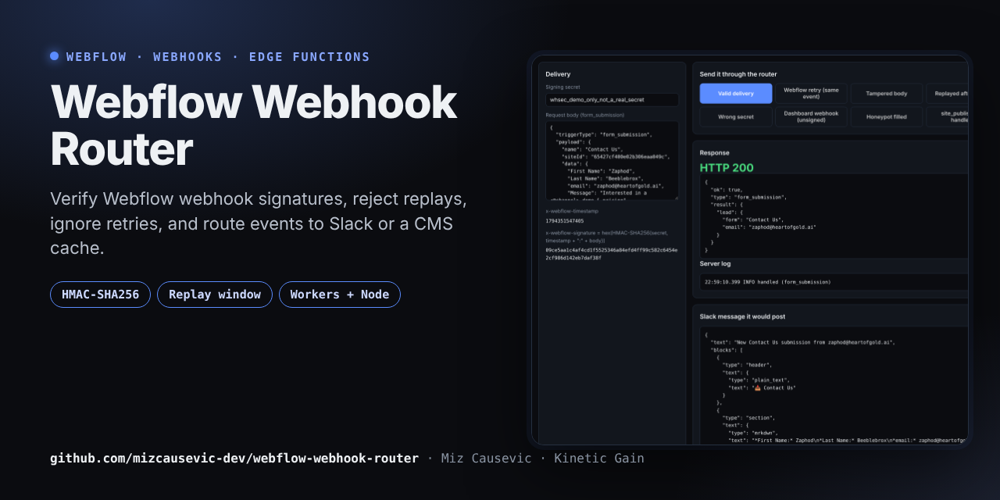
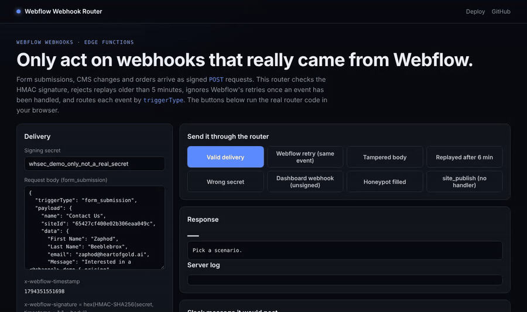

# Webflow Webhook Router

[](https://github.com/mizcausevic-dev/webflow-webhook-router/actions/workflows/ci.yml)
[](https://mizcausevic-dev.github.io/webflow-webhook-router/)


**Live demo: https://mizcausevic-dev.github.io/webflow-webhook-router/**. It sends valid, tampered, replayed and unsigned deliveries through the real router code in your browser.

[](https://mizcausevic-dev.github.io/webflow-webhook-router/)

A production-shaped receiver for **Webflow webhooks**. It verifies the `x-webflow-signature` HMAC, rejects stale or replayed requests, ignores Webflow's retries once an event has been handled, and routes each event by `triggerType` to handlers. The same code runs on **Cloudflare Workers** and **Node 20+**, using Web Crypto with no dependencies.

## See it in action



## Why it matters

Webflow form submissions and CMS events are how Webflow sites connect to CRMs, Slack, headless front ends and order systems. A careless receiver trusts unsigned requests, double-processes Webflow's automatic retries, or lets a visitor's form input ping `@channel`. This one doesn't.

## How it handles each delivery

```
POST /webhooks/webflow
  ├─ 405  not POST
  ├─ 413  body > 256 KB
  ├─ 401  missing headers · malformed · outside ±5 min · HMAC mismatch   (reason logged, never echoed)
  ├─ 400  invalid JSON / no triggerType
  ├─ 200  duplicate delivery (already handled) → acknowledged, not re-run
  ├─ 200  verified, no handler for this triggerType → acknowledged
  ├─ 200  handler succeeded → event remembered for idempotency
  └─ 500  handler threw → NOT remembered, so Webflow's retry gets another chance
```

Webflow treats **any non-200 response** as a failed delivery and retries up to 3 more times at 10-minute intervals. That's why unhandled events return `200` and not `202`, and why handler failures return `500` on purpose.

## Signature scheme (per Webflow's docs)

```
x-webflow-signature = hex( HMAC-SHA256( key, x-webflow-timestamp + ":" + body ) )
key = the webhook's own secret (site-token webhooks created after 14 Apr 2025)
    | the OAuth app's client secret (app-created webhooks)
x-webflow-timestamp = Unix epoch milliseconds; reject if older than 5 minutes
```

The router checks the raw bytes first. It then falls back to Webflow's documented `JSON.stringify(parsed body)` form, which tolerates proxies that re-serialize JSON whitespace. A test checks the Web Crypto signature against an independent `node:crypto` HMAC.

## Included handlers

| triggerType | Handler |
|---|---|
| `form_submission` | Normalizes the lead (name and email detection across field-naming styles), drops honeypot-filled spam, posts a Slack Block Kit message with mrkdwn escaping |
| `collection_item_changed`, `collection_item_published` | Converts the event into cache tags (`collection:<id>`, `item:<slug>`) for an edge cache or headless rebuild |

All 14 documented trigger types are recognized. Registering a handler for a misspelled type throws at startup.

## Deploy

```bash
# Cloudflare Workers
npx wrangler secret put WEBFLOW_WEBHOOK_SECRET
npx wrangler secret put SLACK_WEBHOOK_URL     # optional
npx wrangler deploy                           # optional KV binding WEBHOOK_DEDUPE for cross-isolate idempotency

# Node 20+
WEBFLOW_WEBHOOK_SECRET=… SLACK_WEBHOOK_URL=… node src/node-server.js
```

## Architecture

```
src/verify.js      Web Crypto HMAC, constant-time compare, timestamp window
src/router.js      fetch-style (Request) => Response pipeline, status contract above
src/dedupe.js      MemoryDedupe (TTL + size cap) and KvDedupe (Cloudflare KV)
src/handlers/      forms.js (lead + Slack), cms.js (cache tags)
src/worker.js      Cloudflare Workers entry
src/node-server.js node:http adapter with streaming size cap
index.html         browser demo: the real router, 8 scenarios
```

## Verification status

- **Tested:** 13 tests. They cover signature verification against an independent HMAC implementation, all rejection paths, the documented re-serialization fallback, duplicate suppression, retry after handler failure, honeypot, Slack escaping, cache tags, and the Worker entry point.
- **Not yet tested:** a delivery from a live Webflow site, which needs a site with an API-created webhook. Production use should add a durable idempotency store such as KV or Redis.

## License

MIT © 2026 Mirza Causevic / Kinetic Gain LLC. Independent project, not affiliated with Webflow, Inc.
